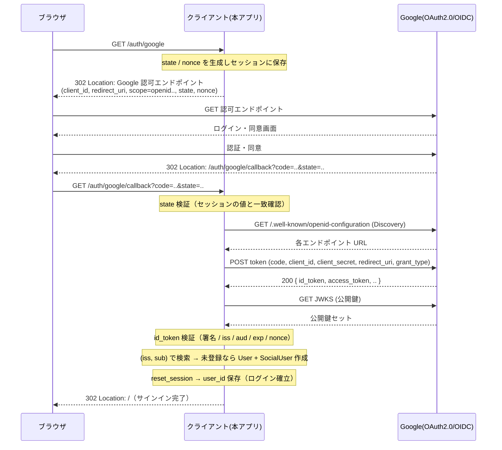
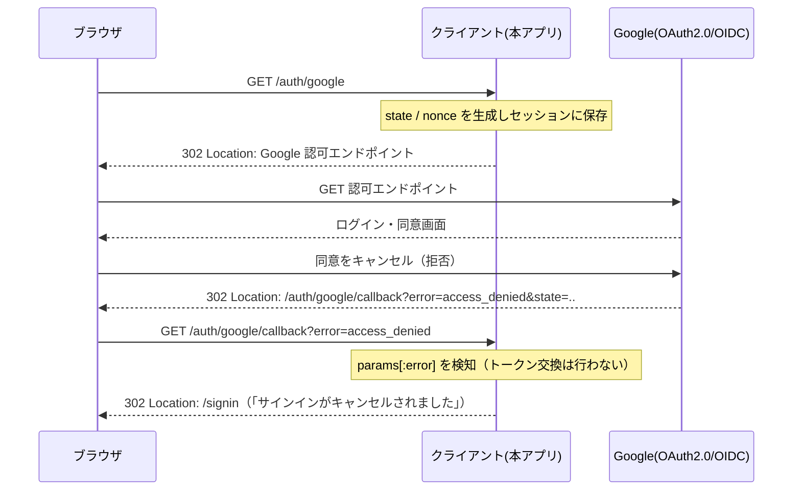
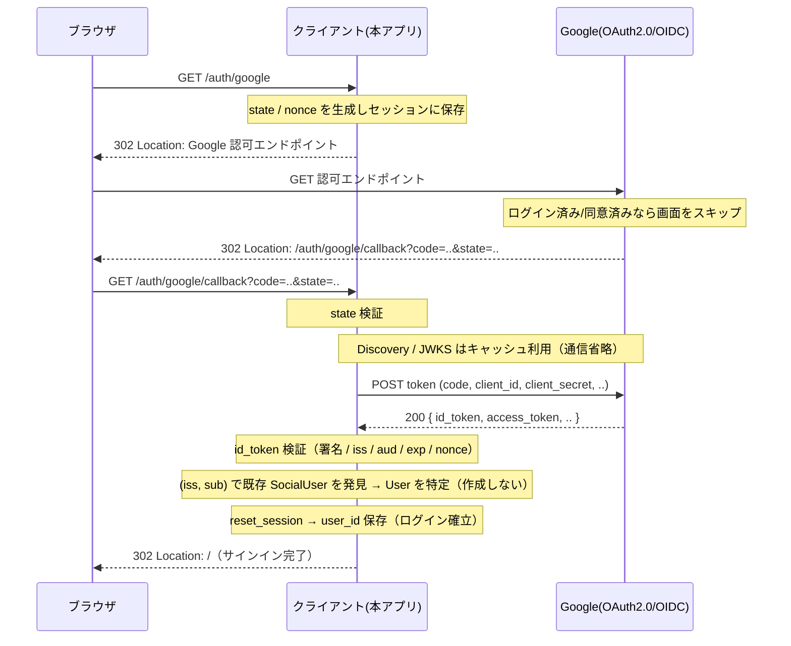

# Rails 学習アウトプット — Google OIDC サインインの自前実装

Rails Tutorial 完走後の学習アウトプットです。
認証ライブラリ（omniauth 等）に頼らず、**Google アカウントによる OIDC（OpenID Connect）サインインを認可コードフローから自前実装**した Rails アプリです。開発環境は Docker で構築しています。

## 目的
- Rails Tutorial で学んだログイン機構とテーブル CRUD を、ゼロから再現して知識を定着させる
- OIDC 認可コードフローを自分の手で実装し、「なぜその手順・対策が必要か」を理解する

## 注意
- 学習・概念理解を主眼としているため、作り込みよりも仕組みの理解を優先している
- テストコードは未整備
    - OIDC の確認は HTTP ヘッダの検証と実画面での目視程度にとどめている
- 本番運用にはさらなる対策が必要
    - HTTPS の強制、セッションの強制失効（サーバー側セッション化）など

## 利用技術
- OS
    - Debian 系（`ruby:3.4-slim-bookworm` ベース）
- 言語・フレームワーク
    - Ruby 3.4
    - Rails 8.1
- アプリケーションサーバー
    - Puma
- データベース
    - PostgreSQL 17
- 認証
    - Google OIDC（認可コードフロー）を自前実装
    - ID トークンの署名検証のみ `jwt` gem を利用
- コンテナ
    - Docker / Docker Compose

## 設計のポイント
- **認証情報は User に持たせない**
    - ログイン情報は `SocialUser`（OIDC の `iss` / `sub`）に分離し、User は `name` のみ保持
- **ユーザーは初回サインイン時に自動作成**
    - OIDC 前提のため手動登録フォームは持たず、`(iss, sub)` を元に User と SocialUser を同時作成
- **セキュリティ対策を明示的に実装**
    - nonce（リプレイ対策）
    - ID トークンの署名・`iss`・`aud`・`exp` 検証
    - ログイン時の `reset_session`（セッション固定化対策）
- **秘密情報は環境変数で管理**
    - `client_secret` 等は `.env`（Git 管理外）から注入し、ソースにもリポジトリにも含めない

## ディレクトリ構成
```text
demo/
├── Dockerfile            # Rails 開発用イメージ (Debian slim ベース)
├── docker-compose.yml    # web(Rails) + db(PostgreSQL) をまとめて起動
├── .env.example          # 環境変数のサンプル（実値は .env に記入 / .env は Git 管理外）
├── .gitignore
├── README.md
└── src/                  # Rails アプリ本体（app/ と紛らわしくないよう src/ に配置）
    ├── app/
    │   ├── controllers/
    │   │   └── sessions_controller.rb   # OIDC 認可コードフローの制御
    │   ├── services/
    │   │   └── google_oidc.rb           # トークン交換・ID トークン検証
    │   ├── helpers/
    │   │   └── sessions_helper.rb       # log_in / current_user / log_out
    │   └── models/
    │       ├── user.rb                  # name のみ（認証情報は持たない）
    │       ├── micropost.rb             # message / user_id
    │       └── social_user.rb           # iss / sub / email / user_id
    └── config/
        ├── routes.rb
        └── database.yml                 # 環境変数で db コンテナに接続
```

## 起動方法
### 1. Google OAuth クライアントを用意（初回のみ）
- Google Cloud Console で OAuth クライアント（ウェブアプリケーション）を作成する
- 承認済みリダイレクト URI に `http://localhost:3000/auth/google/callback` を登録する
- 発行された クライアント ID / クライアントシークレット を控える

### 2. 環境変数を設定
`.env.example` をコピーして `.env` を作成し、取得した値を記入する。

```bash
cp .env.example .env
# .env を編集:
#   GOOGLE_CLIENT_ID=...
#   GOOGLE_CLIENT_SECRET=...
#   GOOGLE_REDIRECT_URI=http://localhost:3000/auth/google/callback
```

### 3. ビルドとデータベース作成
```bash
docker compose build
docker compose run --rm web bin/rails db:create db:migrate
```

### 4. 起動
```bash
docker compose up
```

ブラウザで http://localhost:3000 を開き、「サインイン」から Google ログインを試せる。


## シーケンス図
- エンティティ
    - **ブラウザ**: ユーザーの操作主体
    - **クライアント (本アプリ / RP)**: 認証を Google に委ね、結果を受け取る
    - **Google (OAuth 2.0 / OIDC サーバー)**: 認証・認可を行い、トークンと公開鍵を提供する

> 実装範囲は「認可コード取得 → Discovery でエンドポイント取得 → トークンエンドポイントで
> `id_token` / `access_token` 取得 → JWKS で公開鍵を取得 → `id_token` の署名・クレーム検証 →
> ユーザー確定・ログイン」まで。トークン取得後、検証のために JWKS を取りに行く往復まで含む。

### 1. 認可フロー（認可成功）



### 2. 認可フロー（認可拒否）

ユーザーが同意画面でキャンセルした場合。Google は `error` を付けてコールバックへ戻す。



### 3. 認可フロー（認可成功・2 回目以降）

2 回目以降は、(iss, sub) に対応する `SocialUser` が既に存在するためユーザーは作成されない。
また Discovery / JWKS は `Rails.cache` にキャッシュ済みのため、通信を省略できる。
（Google 側も、ログイン済みなら同意画面をスキップすることが多い）


