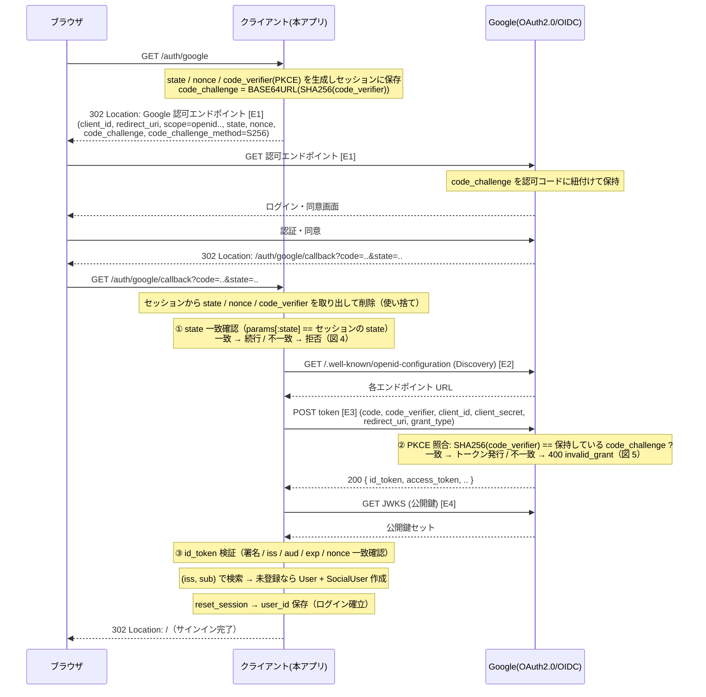
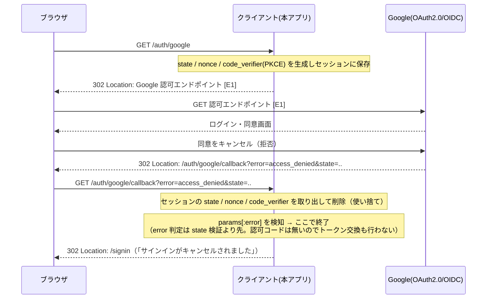
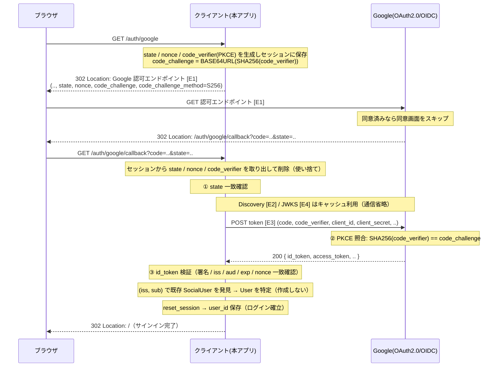
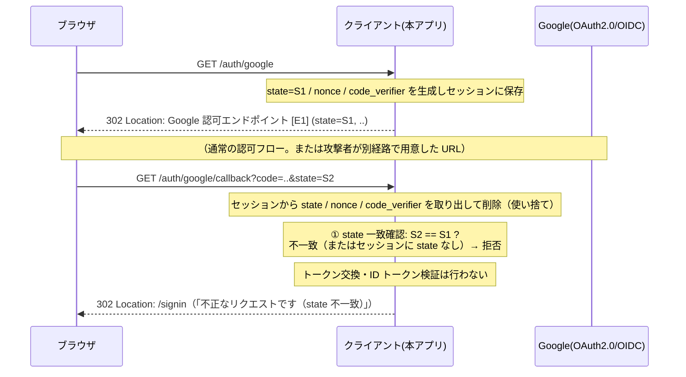
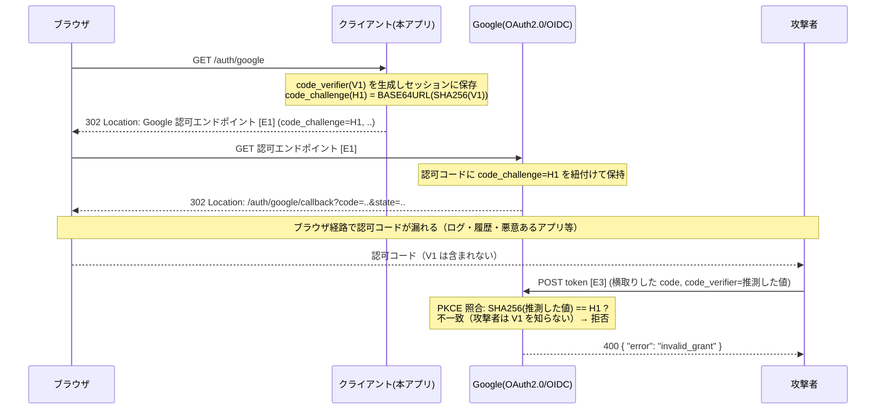

# Rails 学習アウトプット — Google OIDC サインインの自前実装

Rails Tutorial 完走後の学習アウトプットです。
認証ライブラリ（omniauth 等）に頼らず、**Google アカウントによる OIDC（OpenID Connect）サインインを認可コードフローから自前実装**した Rails アプリです。開発環境は Docker で構築しています。

## 目的
- OIDC 認可フローを実装し、理解を深める
- Rails Tutorial 完走後、ログイン機構・テーブル CRUD を再現して知識を定着させる

## 利用技術
| 区分 | 技術 | バージョン・補足 |
| --- | --- | --- |
| OS | Debian 系 | `ruby:3.4-slim-bookworm` ベース |
| 言語 | Ruby | 3.4 |
| フレームワーク | Rails | 8.1 |
| アプリケーションサーバー | Puma | |
| データベース | PostgreSQL | 17 |
| 認証 | Google OIDC | 認可コードフローを自前実装 |
| ライブラリ | `jwt` gem | ID トークンの署名検証のみに利用 |
| コンテナ | Docker / Docker Compose | |

## 設計のポイント
- **認証情報は User に持たせない**
    - ログイン情報は `SocialUser`（OIDC の `iss` / `sub`）に分離し、User は `name` のみ保持
- **ユーザーは初回サインイン時に自動作成**
    - OIDC 前提のため手動登録フォームは持たず、`(iss, sub)` を元に User と SocialUser を同時作成
- **秘密情報は環境変数で管理**
    - `client_secret` 等は `.env`（Git 管理外）から注入し、ソースにもリポジトリにも含めない

## セキュリティ対策

### state の利用
- クライアントが `state`（ランダム値）を生成してセッションに保存し、認可エンドポイントへ渡す
- クライアントは認可コード受領時（コールバック）に、受け取った `state` がセッションの値と一致するか確認する
- → **CSRF 対策**。攻撃者が用意した認可コードを、被害者のブラウザに挿入（コールバック）させることを防ぐ

### PKCE の利用
- クライアントが `code_verifier`（ランダム値）を生成してセッションに保存する
- クライアントは `code_challenge_method`（`S256`）で `code_verifier` をハッシュ化（SHA-256 → BASE64URL）した `code_challenge` を、認可エンドポイントへ渡す
- クライアントは認可コード受領後、`code_verifier` をトークンエンドポイントへ渡す
- 認可サーバー（Google）は、以前受領した `code_challenge_method` で `code_verifier` をハッシュ化し、以前受領した `code_challenge` と一致するか確認する。不一致なら `invalid_grant` で拒否する
- → **認可コードの横取り防止**。認可リクエストにはハッシュ（`code_challenge`）しか載らないため、認可コードを盗んだ攻撃者は `code_verifier` を作れず、トークンに交換できない

### その他
- **nonce**: ID トークン内の `nonce` が、認可リクエスト時にセッションへ保存した値と一致するか検証する（リプレイ対策）
- **ID トークンの検証**: 署名（Google の公開鍵 / JWKS）・`iss`・`aud`・`exp` を検証する
- **reset_session**: ログイン時にセッションを作り直す（セッション固定化対策）
- **使い捨て**: `state` / `nonce` / `code_verifier` は、コールバックに入った時点でセッションから削除する

## ディレクトリ構成
```text
demo/
├── Dockerfile            # Rails 開発用イメージ (Debian slim ベース)
├── docker-compose.yml    # web(Rails) + db(PostgreSQL) をまとめて起動
├── .env.example          # 環境変数のサンプル（実値は .env に記入 / .env は Git 管理外）
├── .gitignore
├── README.md
└── src/                  # Rails アプリ本体（app/ と紛らわしくないよう src/ に配置）
    ├── app/
    │   ├── controllers/
    │   │   └── sessions_controller.rb   # OIDC 認可コードフローの制御
    │   ├── services/
    │   │   └── google_oidc.rb           # トークン交換・ID トークン検証
    │   ├── helpers/
    │   │   └── sessions_helper.rb       # log_in / current_user / log_out
    │   └── models/
    │       ├── user.rb                  # name のみ（認証情報は持たない）
    │       ├── micropost.rb             # message / user_id
    │       └── social_user.rb           # iss / sub / email / user_id
    └── config/
        ├── routes.rb
        └── database.yml                 # 環境変数で db コンテナに接続
```

## 起動方法
### 1. Google OAuth クライアントを用意（初回のみ）
- Google Cloud Console で OAuth クライアント（ウェブアプリケーション）を作成する
- 承認済みリダイレクト URI に `http://localhost:3000/auth/google/callback` を登録する
- 発行された クライアント ID / クライアントシークレット を控える

### 2. 環境変数を設定
`.env.example` をコピーして `.env` を作成し、取得した値を記入する。

```bash
cp .env.example .env
# .env を編集:
#   GOOGLE_CLIENT_ID=...
#   GOOGLE_CLIENT_SECRET=...
#   GOOGLE_REDIRECT_URI=http://localhost:3000/auth/google/callback
```

### 3. ビルドとデータベース作成
```bash
docker compose build
docker compose run --rm web bin/rails db:create db:migrate
```

### 4. 起動
```bash
docker compose up
```

ブラウザで http://localhost:3000 を開き、「サインイン」から Google ログインを試せる。

## URLs

### 本アプリのエンドポイント
| メソッド | パス | 役割 |
| --- | --- | --- |
| GET | `/signin` | サインイン画面（Google ログインボタン） |
| GET | `/auth/google` | 認可リクエストの開始（Google へリダイレクト） |
| GET | `/auth/google/callback` | 認可コードの受け取り。Google が返した `302` の `Location`（`redirect_uri` に認可コードと `state` を付けた URL）に従って、ブラウザがアクセスしてくる |
| DELETE | `/signout` | サインアウト |

`/auth/google/callback` は、Google Cloud Console の「承認済みのリダイレクト URI」に登録した値と完全一致させる必要がある。

### Google のエンドポイント
項番（E1〜E4）は、後述のシーケンス図のメッセージに付けた項番と対応している。項番は、認証フローの中で呼ばれる順に振っている。

URL は、`https://` にホストとパスをつなげたもの。

| 項番 | 名前 | ホスト | パス | 用途 |
| --- | --- | --- | --- | --- |
| E1 | 認可エンドポイント | `accounts.google.com` | `/o/oauth2/v2/auth` | 認可リクエストの送信先 |
| E2 | Discovery | `accounts.google.com` | `/.well-known/openid-configuration` | 各エンドポイントの URL を取得する |
| E3 | トークンエンドポイント | `oauth2.googleapis.com` | `/token` | 認可コードをトークンに交換する |
| E4 | JWKS | `www.googleapis.com` | `/oauth2/v3/certs` | ID トークンの署名検証に使う公開鍵 |

E3 と E4 の URL は、E2 の Discovery ドキュメント（`token_endpoint` / `jwks_uri`）から取得して使う。E1 のみ、コード内の定数（`GOOGLE_AUTH_ENDPOINT`）として持っている。

シーケンス図との対応は次のとおり。

- **E1**: クライアントが `302 Location: Google 認可エンドポイント [E1]` でブラウザにリダイレクト先として指示し、ブラウザが `GET 認可エンドポイント [E1]` で Google にアクセスする
- **E2**: クライアントが `GET /.well-known/openid-configuration (Discovery) [E2]` で Google に問い合わせる（図 1）。図 3 ではキャッシュを使うので通信しない
- **E3**: クライアントが `POST token [E3]` で Google に送る（図 1・図 3）。図 5 では攻撃者が同じエンドポイントに送る
- **E4**: クライアントが `GET JWKS (公開鍵) [E4]` で Google から取得する（図 1）。図 3 ではキャッシュを使うので通信しない

### 認証 URI パラメータ
認可エンドポイント（E1）に渡せるクエリパラメータ。Google のドキュメントの表にあるものに、PKCE のパラメータを加えている。

- **定義**: そのパラメータを定めている仕様。OAuth 2.0、OIDC、Google 独自のいずれか
- **目的**: そのパラメータで防ぎたい攻撃や、守りたい原則。明確なものがないパラメータは「ー」とした

| パラメータ | 定義 | 目的 | 説明 |
| --- | --- | --- | --- |
| `client_id` | OAuth 2.0 | ー | 必須。Cloud Console で取得したクライアント ID |
| `redirect_uri` | OAuth 2.0 | リダイレクト先のすり替えによる認可コードの漏えい | 必須。ブラウザのリダイレクト先。事前登録した値と一致している必要があり、Google はこの URI を `302` の `Location` に入れて返す |
| `response_type` | OAuth 2.0 | ー | 必須。`code` を指定すると認可コードフローになる |
| `scope` | OAuth 2.0 | 取得する情報の範囲の限定（最小権限） | 必須。先頭は `openid`（OIDC のスコープ）にし、`profile` と `email` のどちらか、または両方を続ける（スペース区切り） |
| `state` | OAuth 2.0 | CSRF（ログイン CSRF） | 任意（強く推奨）。リクエストとレスポンスの往復で、そのまま返される値。リダイレクト先は推測できるため、自分が開始した認証のレスポンスかを `state` で検証する |
| `code_challenge` | OAuth 2.0（拡張: PKCE） | 認可コードの横取り | 任意。`code_verifier` を `code_challenge_method` でハッシュ化した値 |
| `code_challenge_method` | OAuth 2.0（拡張: PKCE） | 認可コードの横取り | 任意。`code_challenge` の生成方法 |
| `nonce` | OIDC | ID トークンのリプレイ攻撃 | 必須。ID トークンに埋め込まれて返る |
| `prompt` | OIDC | ー | 省略可。ユーザーに再認証や同意を求めるかどうか。スペース区切りで複数指定できる。`none`: 認証・同意の画面を出さず、未認証や未同意ならエラーを返す。`consent`: 同意を求める。`select_account`: アカウントの選択を求める。未指定で、ユーザーが未承認なら同意画面を表示する |
| `login_hint` | OIDC | 別のアカウントでサインインしてしまう誤りの回避 | 省略可。認証したいユーザーが分かっているときのヒント。アカウント選択を省略し、メール欄の事前入力や、適切なセッションの選択を行う。値はメールアドレスまたは `sub` |
| `display` | OIDC | ー | 省略可。認証・同意画面の表示方法（`page` / `popup` / `touch` / `wap`）。Google は受け付けるが、プロトコルの動作には影響しない |
| `claims` | OIDC | ー | 省略可。UserInfo エンドポイントや ID トークンに含める任意の項目を、JSON で指定する。Google は `amr`（最後の認証方法）と `auth_time`（最後の認証時刻）を受け付ける。どちらも設定での有効化が必要 |
| `access_type` | Google 独自 | ー | 省略可。`offline` または `online`。アクセストークンを要求する場合、`offline` を指定しないとリフレッシュトークンは受け取れない |
| `include_granted_scopes` | Google 独自 | ー | 省略可。`true` を指定すると、過去に付与されたスコープも今回の認可に含める。インストール済みアプリのフローでは使えない |
| `hd` | Google 独自 | ー | 省略可。Google Cloud 組織のドメイン（例: `mycollege.edu`）を指定すると、アカウント選択 UI をそのドメイン向けに最適化する。`hd=*` で組織アカウント全般。クライアント側で改ざんできるため、アクセス制御には使えない。制限する場合は、ID トークンの `hd` クレームを検証する |
| `hl` | Google 独自 | ー | 省略可。サインイン・アカウント選択・同意画面の表示言語（BCP 47 の言語タグ。例: `en-GB`）。未指定なら、アカウントまたはブラウザの設定に従う |

- 「定義」と「目的」の列は、Google のドキュメントの表にはない。OpenID Connect Core 1.0、OAuth 2.0（RFC 6749）、PKCE（RFC 7636）の仕様をもとに整理した。
- `code_challenge` と `code_challenge_method` は、Google のドキュメントの表には載っていない。Discovery ドキュメントの `code_challenge_methods_supported` に `plain` と `S256` が含まれることを確認している。
- 実際に組み立てられる URL では、Rails の `to_query` によりパラメータ名がアルファベット順に並ぶ。

```text
https://accounts.google.com/o/oauth2/v2/auth
  ?client_id=<CLIENT_ID>
  &code_challenge=<CODE_CHALLENGE>
  &code_challenge_method=S256
  &nonce=<NONCE>
  &redirect_uri=http%3A%2F%2Flocalhost%3A3000%2Fauth%2Fgoogle%2Fcallback
  &response_type=code
  &scope=openid+email+profile
  &state=<STATE>
```

### トークンリクエストのパラメータ
トークンエンドポイント（E3）へ `POST` で送るパラメータ。`application/x-www-form-urlencoded` のフォーム形式で、サーバー間の通信として送る。「定義」と「目的」の見方は、認証 URI パラメータの表と同じ。

| パラメータ | 定義 | 目的 | 説明 |
| --- | --- | --- | --- |
| `code` | OAuth 2.0 | ー | 必須。認可エンドポイントから受け取った認可コード |
| `client_id` | OAuth 2.0 | ー | 必須。Cloud Console で取得したクライアント ID |
| `client_secret` | OAuth 2.0 | クライアントのなりすまし | 必須。Cloud Console で取得したクライアントシークレット。サーバー間の通信でのみ送り、ブラウザには渡さない |
| `redirect_uri` | OAuth 2.0 | ー | 必須。最初の認可リクエストで使ったものと同じ値 |
| `grant_type` | OAuth 2.0 | ー | 必須。`authorization_code` を指定する |
| `code_verifier` | OAuth 2.0（拡張: PKCE） | 認可コードの横取り | 任意。認可リクエストの前に生成した `code_verifier` の本体。Google が `code_challenge_method` でハッシュ化し、認可リクエストの `code_challenge` と一致するか確認する |

- `code_verifier` は、Google のドキュメントの表には載っていない。PKCE のパラメータで、認可リクエストの `code_challenge` と対になる。
- `client_secret` は、Google のドキュメントによって「必須」と「省略可」の記載が分かれている。本アプリは常に送っている。
- クライアント認証は、`client_id` と `client_secret` を HTTP ボディに入れる方式（`client_secret_post`）を使っている。`Authorization: Basic` ヘッダで送る方式（`client_secret_basic`）は使っていない。Google の Discovery ドキュメントの `token_endpoint_auth_methods_supported` には、どちらも含まれている。
- 通信は HTTPS で暗号化されるので、通信路での安全性は、どちらの方式でも変わらない。RFC 6749 はボディに入れる方式を「推奨しない」としているが、これは Basic 認証を使えないクライアント向けの代替という位置づけである。本アプリは、Google のドキュメントのサンプルに合わせて、ボディに入れる方式にしている。
- 下のサンプルの改行は、読みやすさのためのもの。実際のボディは 1 行で送る。

```text
POST /token HTTP/1.1
Host: oauth2.googleapis.com
Content-Type: application/x-www-form-urlencoded

code=<CODE>
&client_id=<CLIENT_ID>
&client_secret=<CLIENT_SECRET>
&redirect_uri=http%3A%2F%2Flocalhost%3A3000%2Fauth%2Fgoogle%2Fcallback
&grant_type=authorization_code
&code_verifier=<CODE_VERIFIER>
```

### 出典
- Google for Developers「OpenID Connect」の「Authentication URI parameters」
  https://developers.google.com/identity/openid-connect/openid-connect?hl=ja#authenticationuriparameters
- Google for Developers「Using OAuth 2.0 for Web Server Applications」の「HTTP/REST」（認可コードをトークンに交換する）
  https://developers.google.com/identity/protocols/oauth2/web-server?hl=ja

## シーケンス図
- エンティティ
    - **ブラウザ**: ユーザーの操作主体
    - **クライアント (本アプリ / RP)**: 認証を Google に委ね、結果を受け取る
    - **Google (OAuth 2.0 / OIDC サーバー)**: 認証・認可を行い、トークンと公開鍵を提供する

> 実装範囲は「認可リクエスト（state / nonce / PKCE の code_challenge 付き）→ 認可コード取得 →
> state 一致確認 → Discovery でエンドポイント取得 → トークンエンドポイントで（code_verifier を送って）
> `id_token` / `access_token` 取得 → JWKS で公開鍵を取得 → `id_token` の署名・クレーム検証 →
> ユーザー確定・ログイン」まで。トークン取得後、検証のために JWKS を取りに行く往復まで含む。
>
> 図中の ①②③ は「一致確認」の箇所を表す。① state 一致確認（本アプリ）、② PKCE 照合（Google）、
> ③ ID トークンの検証（署名・`iss`・`aud`・`exp`・nonce 一致確認。本アプリ）。

### 1. 認可フロー（認可成功）



### 2. 認可フロー（認可拒否）

ユーザーが同意画面でキャンセルした場合。Google は `error` を付けてコールバックへ戻す。



### 3. 認可フロー（認可成功・2 回目以降）

2 回目以降は、(iss, sub) に対応する `SocialUser` が既に存在するためユーザーは作成されない。
また Discovery / JWKS は `Rails.cache` にキャッシュ済みのため、通信を省略できる。
（Google 側も、ログイン済みなら同意画面をスキップすることが多い）



### 4. 認可フロー（state 不一致で拒否）

コールバックの `state` が、認可リクエスト時にセッションへ保存した値と一致しない場合。
他者が用意した認可コードを、被害者のブラウザで強制的にコールバックさせる攻撃（ログイン CSRF）や、
セッションの失効・別ブラウザからのアクセスなどで起きる。**トークン交換には進まない**。



### 5. 認可フロー（PKCE により認可コードの横取りを防ぐ）

ブラウザ経由で渡る認可コードが、攻撃者に横取りされた場合。
認可リクエストに載っているのは `code_challenge`（ハッシュ）だけで、元の `code_verifier` は本アプリのセッション内にしかない。
攻撃者は verifier を作れないため、横取りした認可コードをトークンに交換できない。**トークンは発行されない**。



なお本アプリは `client_secret` もサーバー内でのみ保持しているため、攻撃者はこれも持たない。PKCE はそれとは独立した追加の防御になる。
